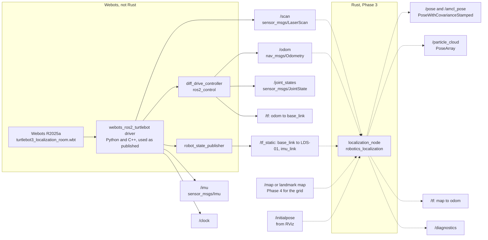

# Phase 3, ROS graph: where the node sits

The simulation side of this graph runs today and the numbers below were measured on it
(see [../../sim/webots/README.md](../../sim/webots/README.md) for the run). The
localization node is Phase 3 work and is drawn dashed.

## 1. The graph



The important property of this picture: the arrow from the simulation to Rust is a plain
topic subscription. Nothing in the driver knows a Rust node exists, nothing in the driver
was changed, and replacing Webots with a real TurtleBot3 changes nothing on the Rust side
either.

## 2. What the simulation publishes

Nominal rates below are the ones configured in the driver URDF and the ros2_control
parameters of `webots_ros2_turtlebot`, which is a property of the configuration, not a
measurement. Measured rates and one sample message per topic are recorded per run under
[`../../sim/webots/evidence/`](../../sim/webots/evidence/) and are deliberately not copied
into this text.

| Topic | Type | Frame | Nominal | Published by |
|---|---|---|---|---|
| `/scan` | `sensor_msgs/LaserScan` | `LDS-01` | 5 Hz | driver, lidar device |
| `/odom` | `nav_msgs/Odometry` | `odom` to `base_link` | 50 Hz | `diff_drive_controller` |
| `/imu` | `sensor_msgs/Imu` | `imu_link` | 20 Hz | driver, `Ros2IMU` plugin |
| `/joint_states` | `sensor_msgs/JointState` | wheel joints | 50 Hz | `joint_state_broadcaster` |
| `/clock` | `rosgraph_msgs/Clock` | simulation time | 50 Hz | `Ros2Supervisor` |
| `/cmd_vel` | `geometry_msgs/TwistStamped` | input | on demand | consumed by `diff_drive_controller` |

The lidar sweep runs clockwise, from a positive `angle_min` to a negative `angle_max` with
a negative `angle_increment`, and its `range_max` is what the 6 by 6 m room was sized
around, see [problem.md](problem.md). The exact geometry and how many beams return a
finite range from a given pose are in the recorded `/scan` sample of a run, not here.

Three details a Rust consumer has to handle, all verified on the running stack:

1. **Topic name.** The driver publishes `/imu`, while the Phase 2 nodes of this repository
   subscribe to `imu/data`. This is resolved with a launch level remap on the Rust node.
   The driver is not touched.
2. **Frame name.** The lidar frame is `LDS-01`, not `laser` as in the Phase 2 simulator.
   `base_link -> LDS-01` comes from `robot_state_publisher` on `/tf_static`, so the right
   fix is to read the transform from TF instead of assuming a frame name.
3. **Covariances are zero.** Every entry of `pose.covariance` and `twist.covariance` on
   `/odom`, and `orientation_covariance` on `/imu`, is `0.0`. The reference stack publishes
   no uncertainty at all, so a consumer that needs one has to supply its own noise model,
   which is what [`motion/odometry.rs`](../../crates/robotics_models/src/motion/odometry.rs)
   is for.

## 3. TF tree

Published today:

```text
odom -> base_link            diff_drive_controller, dynamic, with /odom
base_link -> base_footprint  static_transform_publisher
base_link -> LDS-01          robot_state_publisher, static
base_link -> imu_link        robot_state_publisher, static
base_link -> gyro, accelerometer, inertial_unit, compass, wheels, screws
```

Phase 3 adds exactly one edge, `map -> odom`, owned by `localization_node` alone. The rule
is the one from [TF_BUFFER.md](../TF_BUFFER.md) and REP 105: one owner per edge, no node
rewrites an edge another node publishes. Note that in the Webots stack `odom -> base_link`
belongs to `diff_drive_controller`, not to the Phase 2 `state_estimator_node`, so running
both against this simulation at the same time is a conflict that has to be resolved in the
launch file, not silently.

## 4. Planned interface of `localization_node`

**TODO**, planned, to be confirmed against the implementation
([implementation.md](implementation.md)).

| Direction | Topic | Type | Note |
|---|---|---|---|
| in | `scan` | `sensor_msgs/LaserScan` | sensor QoS, best effort |
| in | `odom` | `nav_msgs/Odometry` | motion input, used as a relative increment |
| in | `map` | `nav_msgs/OccupancyGrid` | latched, Phase 4; landmarks from a parameter file before that |
| in | `initialpose` | `geometry_msgs/PoseWithCovarianceStamped` | from RViz, resets the prior |
| out | `pose`, `amcl_pose` | `geometry_msgs/PoseWithCovarianceStamped` | `map` frame, Nav2 compatible name |
| out | `particle_cloud` | `geometry_msgs/PoseArray` | throttled, visualization only |
| out | `/tf` | `tf2_msgs/TFMessage` | `map -> odom` only |
| out | `/diagnostics` | `diagnostic_msgs/DiagnosticArray` | effective sample size, particle count, gate rejections, mean NIS |

QoS presets come from
[`robotics_ros_bridge::qos`](../../ros2_ws/src/robotics_ros_bridge/src/qos.rs), the same
ones the Phase 1 and Phase 2 nodes use.
